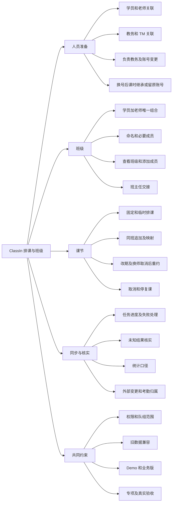
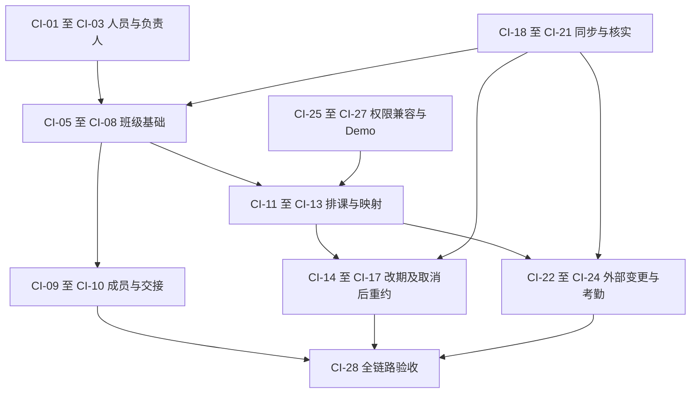

# ClassIn 排课与班级产品功能地图 V1.0

> 最新交互修订：页面反馈、自动重试和同步日志展示以[简化优化方案](ClassIn同步反馈与页面异常处理补充方案.md)为准。此前独立核实卡片、逐项重试和分步进度描述已被替代；新方案尚未完成实作验收。

2026-11-20 · **本地核心功能已实现；功能级实现状态见第 6 节，实际测试证据见[实施记录](ClassIn排课与班级实施记录.md)。完整验收和真实 ClassIn 联调尚未完成。**

同日修订：换老师统一改为“取消原老师固定占位及未上预约，再重新排课”。CI-15/CI-16 已重写，原跨班迁移设计不再适用。

最新补充：CI-04 增加独享换号继承余额、共享拆出余额留原账号；CI-10 允许新教务仅作为成员加入；CI-23 对收到的已知课程变更自动同步；CI-26 已确定旧预约不搬迁。对应验收扩展至 AC-52，已执行的分支及仍待执行项逐条记录在实施记录中。

配套：[修改优化方案](ClassIn排课与班级改造方案_V1.0.md) · [验收清单](ClassIn排课与班级验收清单_V1.0.md)。编号用于开发任务、测试用例和问题单；不要另起一套无法对应的编号。

## 1. 一眼看懂产品结构

数据关系：一个学员可以有多个班级，每个班级固定对应一位老师；一个班级有多节课；每节课有自己的外部课堂映射。换师取消的旧课与新预约是不同课节，旧记录及映射保留。ClassIn 账号可被多个学员共用，但不改变这层关系。

**示例：**小明 `10000001` 与小红 `10000002` 共用账号 U1。给小明排 Alice 两节、Bob 一节，给小红排 Alice 一节，目标是 **3 个班级、4 个课堂**；两人共用 U1 的一份余额，班级仍按各自内部学员 ID 分开。

## 2. 功能明细

下表保留目标行为与开发批次；改造范围不是验收结论。M1～M4 不是已发布版本，实现与验证状态见第 6 节。

### A. 人员准备

|编号 / 功能|用户入口与操作|目标结果与关键边界|改造范围 / 批次|验收|
|---|---|---|---|---|
|CI-01 学员、老师关联|学员详情/老师详情 → ClassIn 账号 → 输入手机号或邮箱 → 关联|保留已有账号逻辑、机构加入提示、UID 更换确认；保存失败可重新保存；不出现密码、代注册或 UID 手填|已有，保留及专项验证 / M1|AC-01～AC-03|
|CI-02 教务、TM 关联|设置 → 团队账号 → 选择教务/TM → 关联 ClassIn|持久化 UID；外部为机构教师，本地仍为原角色；TM 不自动入班；不另造授课老师档案|新增 / M1|AC-04、AC-05|
|CI-03 负责教务准确关联|学员资料 → 负责教务 → 按姓名和队组选择|保存账号 ID，作为班主任设置/成员加入的目标人；重名/未匹配须明确分配；改名不丢归属；外部实际身份按 CI-10 展示|现有姓名关联需改造 / M1|AC-06～AC-08|
|CI-04 学员换号与余额去向|核实新账号 → 预览原/新账号成员、余额及 A 的待取消课程 → 取消确认 → 改绑 → 重新排课|独享账号剩余余额继承；共享账号 A 离开后余额全留原账号，B 预约不动；新号不复制旧余额；只替换 A 班的学生账号，历史消费来源保留|新增允许共享学员单独换号；D-06 已确定 / M3|AC-09、AC-47～AC-52|

### B. 班级生成与查看

|编号 / 功能|用户入口与操作|目标结果与关键边界|改造范围 / 批次|验收|
|---|---|---|---|---|
|CI-05 按学员＋老师建班和复用|首次排课自动建班，同组合以后追加|相同组合只有一班；不同老师/不同本地学员分别建班；教学计划改变不新建；结束/删除/容量异常不自动另建|新增；容量恢复依赖 D-08 / M2|AC-10～AC-12、AC-18|
|CI-06 班级命名|排课确认和班级详情查看生成名称|严格使用中文名＋现有学员 ID＋老师英文名；缺项定位；不静默截断；名称不作为查班条件|新增；后续更名 D-05 / M2|AC-13|
|CI-07 必要成员与班主任|系统在首次建班时自动处理|负责教务为班主任；学生和授课老师入班；逐成员确认成功后再建课堂；同 UID 不重复成员操作|新增 / M2|AC-19～AC-21|
|CI-08 班级列表及详情|学员详情 → ClassIn 班级 → 打开某班|显示老师、班主任、成员、课节、外部编号、进度/失败；无班级有空态；新旧规则来源可区分|新增 / M2|AC-23、AC-43、AC-44|

### C. 班级协作

|编号 / 功能|用户入口与操作|目标结果与关键边界|改造范围 / 批次|验收|
|---|---|---|---|---|
|CI-09 添加协作成员|班级详情 → 添加成员 → 选教务/老师/TM → 提交|只操作所选班；每人显示结果；不改变固定老师、班主任和课堂主讲；已加入不可重复；无权限不可提交|新增；D-10 / M3|AC-24、AC-25、AC-43|
|CI-10 更换负责教务|修改负责教务或账号停用交接 → 预览学员、课程和相关班级|归属转给 B；确认能设置则 B 任班主任，确认不能则 B 入班即可；两种结果如实显示；超时不当作不支持；不改课程老师/时间|新增；D-01 规则已定、机构能力待联调 / M3|AC-26、AC-08|

### D. 排课

|编号 / 功能|用户入口与操作|目标结果与关键边界|改造范围 / 批次|验收|
|---|---|---|---|---|
|CI-11 提交前检查|固定/临时排课面板 → 检查资料和课时 → 提交|明确缺少谁的 UID、负责人或中文名；已有 UID 不因联系手机空而失败；时间、余额、锁等原规则仍有效|现有检查增加 ClassIn 条件 / M2|AC-14～AC-16|
|CI-12 固定、临时排课及计划追加|既有排课入口选时段/老师 → 预览新建/复用班级 → 保存|本地保存成功后显示待同步；每节按自身老师入班；批量部分外部失败逐节呈现|改造 / M2|AC-10、AC-11、AC-17、AC-22|
|CI-13 外部课堂映射与去重|后台执行，课节详情可查看结果|保存 courseId/classId/activityId；同一目标重复执行不重复建；旧取消课保留原映射，新预约独立建课；重新关联学员不能绕过组合归属|现有映射扩展 / M2～M3|AC-18、AC-21、AC-30、AC-34|

### E. 课节变化

|编号 / 功能|用户入口与操作|目标结果与关键边界|改造范围 / 批次|验收|
|---|---|---|---|---|
|CI-14 仅改时间|课表/学员课程/课节详情 → 调课，老师不变|原班原课堂改时间；现有时间冲突检查仍执行；平台拒绝时显示差异；变更老师引导换师流程，不能直接改单|原能力专项改造 / M2|AC-27|
|CI-15 换师：结束原关系|学员换老师 → 选原老师 → 预览固定占位和全部未上预约 → 确认取消|只解除该学员＋原老师的排课关系；释放相应锁定/预约占用，取消旧课堂；不需要先选新老师；旧记录、班级和其他老师安排保留|改造；D-03/D-07 已确定 / M3|AC-28、AC-29|
|CI-16 换师：重新预约|原关系取消完成 → 重新排课 → 选新老师、日期、时间及次数 → 提交|复用正常排课；无需承接原时间或原次数；产生新 lessonId/课堂；按组合找或建班；暂不预约或失败时不恢复旧课|复用现有排课入口；D-07 已确定 / M3|AC-30|
|CI-17 单节取消及服务停复课|取消课节，或停课/结课/退款/复课既有入口|仅取消目标课堂；不删共享班级；保留既有占用、扣返、共享退款规则；复课不复活已取消课；换师取消按 CI-15 定向处理|原能力适配共享班级 / M2|AC-31～AC-33|

### F. 同步管理与统计

|编号 / 功能|用户入口与操作|目标结果与关键边界|改造范围 / 批次|验收|
|---|---|---|---|---|
|CI-18 班级和课节后台任务|自动执行，课节/班级详情查看进度|本地业务与任务同事务；班级任务可独立运行；同班依赖等待、无关班继续；旧目标不覆盖新目标|现有 outbox/worker 扩展 / M2～M3|AC-22、AC-32、AC-34、AC-35|
|CI-19 状态和明确失败重试|设置 → ClassIn 同步管理 → 打开事项 → 修正/重试|区分建班、成员、课堂、改期、取消；保留已完成步骤；成员失败不伪报课堂成功|改造 / M2|AC-19、AC-22、AC-23|
|CI-20 未知结果核实恢复|同步管理 → 待核实 → 查看操作与外部证据 → 确认恢复|建班按已知唯一标识契约恢复；其他未知写入禁止盲重建；人工核实有对象、证据、权限、下一步|已有阻断，补恢复入口；D-09 / M2～M3|AC-34、AC-36|
|CI-21 本地记录和同步统计|上课记录筛选、查看汇总、点击同步状态|本地条数不是外部有效课堂数；取消成功、处理中、失败、待核实和历史未核验可区分；明细口径相同|文案及数据口径改造 / M2|AC-37|

### G. 外部变化与上课记录

|编号 / 功能|用户入口与操作|目标结果与关键边界|改造范围 / 批次|验收|
|---|---|---|---|---|
|CI-22 排课变更消息接收|ClassIn 订阅 → 系统收件 → 同步管理查看|验签、去重、分 Cmd 解析，兼容 CourseId；接收班级/课节变化；不把回声当新业务命令|新增 / M4|AC-38、AC-39|
|CI-23 外部改课自动同步|收到 ClassIn 改课通知 → 自动更新已知课程 → 查看处理结果/异常|正常改期/取消自动同步时间、状态和占用，无需逐条批准；冲突记录实际时间并提示；未知映射或归属冲突不猜对象，扣费责任另核实|新增；D-04 自动同步已定、订阅待联调 / M4|AC-40、AC-41|
|CI-24 考勤、旧课记录和扣课归属|收到上课事件 → 课节记录 → 原确认/更正入口|先按外部课堂定位，再核对 UID；共享账号不串课；额外成员不冒充主讲；旧取消课回调不扣新预约|现有处理扩展 / M3～M4|AC-42|

### H. 跨模块约束与交付

|编号 / 功能|用户入口与操作|目标结果与关键边界|改造范围 / 批次|验收|
|---|---|---|---|---|
|CI-25 权限和组织范围|不同角色登录后使用上述入口；直接调用 API|保持学员队组、老师/TM、账号管理范围；外部加入不赋予本地新权限；跨范围提交拒绝|现有权限扩展；D-10 / 全批次|AC-05、AC-08、AC-43|
|CI-26 存量兼容|打开旧课、改期/取消旧课、首次新规则排课|升级前已约课留原班照常上，原映射保留；新增预约走新班；不批量搬迁、不因缺班级引用重复建课|D-02 已确定 / M2|AC-44|
|CI-27 Demo 与业务一致|本地 Demo 和业务入口分别执行相同页面路径|结构/交互一致，Demo 明确模拟；业务失败不回退样本；重读业务数据仍存在|Demo 协议修复并适配 / M1～M4|AC-45|
|CI-28 开发和验收可追踪|用本图领任务，用验收清单记录结果|每个功能有用例、测试层级与证据；真实端可见与可进入独立验；未执行/阻塞不记通过|新增交付约定 / 全批次|AC-46，并检查 AC-01～AC-52 全部适用记录|

## 3. 权限与角色地图

|角色|本系统预期能力|ClassIn 身份|边界|
|---|---|---|---|
|管理员/账号管理员|关联教务/TM，分配负责人；按权限处理班级和异常|不因管理本系统自动成为班主任|账号管理不代表所有用户都需加入全部班级|
|负责教务|现有范围内维护学员、加课时、排课；有班级管理权限时添加成员|新建班优先班主任；交接明确无法设置时作为课程教师入班|本地负责人和外部实际班主任分别展示；不能取本次点击保存的人冒充负责人|
|其他教务|按既有本地权限查看/处理；可被加入指定班级|课程教师成员|不自动替代负责教务|
|授课老师|老师端查看本人课表和学员；不新增成员管理权|对应班级教师、指定课堂主讲|不同老师的班级分开；不能查看其他老师完整班级成员资料|
|TM|账号可关联；可按需被加入指定班级|课程教师成员|不自动加入所负责老师的全部班级；管理权限见 D-10|
|学员/家长|使用已关联 ClassIn 账号看班级、上课|班级学生|共享账号可见多个孩子班级；本期不新做学生端|

所有入口不仅隐藏按钮，还需服务端校验；候选人员显示与提交权限一致。已有敏感信息遮罩继续生效。

## 4. 关键状态与操作结果

|用户操作|本地成功反馈|外部完成标准|失败时保留什么|
|---|---|---|---|
|关联账号|已取得 UID 并保存|对应机构身份确认|已取得结果可重存，不重复索要密码|
|学员换号|A 旧预约取消确认后，本地绑定和余额去向同事务完成|A 班新账号加入、旧账号移除确认，B 班成员和课堂不动|取消失败时原绑定/余额保留；成员阶段失败不重复搬余额；旧课记录保留|
|首次排课|课节和占用已保存，待同步|班级、班主任、必要成员和课堂均确认|班级/成员成功步骤、失败课节|
|追加排课|新增课节待同步|同 courseId 下新增课堂|原有课堂不变|
|添加成员|已提交指定成员|逐成员成功|成功者保留、失败者可定位|
|更换负责教务|学员及课程归新教务，外部处理中|新教务成为班主任，或确认无法设置但已作为成员加入|每班实际身份及原因；加入失败/未知不冒充完成；课程时间/主讲及历史处理人不变|
|换师取消原关系|原老师占位及未上预约已取消，外部取消处理中|本次旧课堂均确认取消，或明确从未外部创建|旧课及原映射、逐课取消结果；其他老师安排保留|
|换师后重新预约|按新老师、新时间生成新的本地课节|按正常排课完成新课堂映射|新预约自身的失败记录；不恢复已取消旧课|
|取消|本地取消，外部取消待同步|原外部课堂确认不可上|取消失败/未知，不能解散整个班|
|外部变更|消息已接收，正常已知变更自动更新|本地时间/状态/占用反映已知外部事实，异常有具体处理项|原始事件、变更前后值；冲突不隐藏，未知对象不猜测|

## 5. 功能依赖与阶段完成判断

领取任务时记录：功能编号、开发人、涉及文件、决策依赖、关联验收编号、实现状态、验证结果、证据位置。完成定义是“目标行为已实现且对应验收有证据”，不是“页面增加了按钮”或“mock 返回了成功”。

D-01/D-02/D-03/D-04/D-06/D-07 的业务规则已经确定，平台实际权限及推送覆盖仍需联调；其余项以主方案登记为准。本图不得恢复旧跨班迁移设计，或把“单个共享学员禁止换号”的旧实现限制当成新需求。

## 6. 本次实现状态（2026-11-20）

|功能|实现状态|证据与剩余边界|
|---|---|---|
|CI-01～CI-03|已实现账号关联扩展、负责人 ID 与队组范围|单测/组件及 HTTP 证据 E1/E3；团队关联真实权限待联调|
|CI-04|已实现取消、余额处理、成员替换分阶段换号|E1/E5/E6；具体分支覆盖见 AC-47～AC-52|
|CI-05～CI-07|已实现组合唯一班级、命名、必要成员及课堂映射|E5 三班四课，E1 签名和单成员结果；平台容量/成员权限待联调|
|CI-08～CI-10|已实现班级列表、额外成员、负责人交接及影响预览|E1/E5；实际班主任权限及客户端可见性待联调|
|CI-11～CI-13|已实现提交前检查、三种排课入口预览及外部编号|E1/E3/E5；真实浏览器串联待验|
|CI-14～CI-17|已实现同老师改期、原关系取消、新预约、旧课保留|E1/E4/E5；不同日期/数量的真实重约待验|
|CI-18～CI-20|已实现班级/课节任务、明确失败重试、未知结果人工核实|E4/E5；不会把未知响应当成功；平台受控故障待验|
|CI-21|已实现六种同步分类统计与明细筛选|E1 AC-37 页面交互通过|
|CI-22～CI-24|已实现通知接收、已知改期/取消回写和原课堂考勤归属|E4/E5 模拟通知通过；真实订阅投递、共享账号访问待验|
|CI-25～CI-26|已实现范围控制和旧映射兼容；本地迁移已应用|E1/E3/E5；真实存量清单核对待验|
|CI-27|Demo 本地流程及模拟关联已适配，外部班级/核实面板仅业务模式显示|没有用 Demo 伪造外部成功；双模式真实浏览器对照待验|
|CI-28|方案、功能编号、AC 目录与实际证据已建立关联|完整 AC 和 L4 尚未全部完成，不标整套交付已验收|

入口权限已落定：班级查看沿用 `lesson.view`，成员添加沿用 `student.reschedule`，异常恢复沿用 `sync.retry`，团队关联沿用 `account.manage`。均保留当前数据范围检查。

## 2026-11-20 同步体验简化补充

当前页面/状态/异常恢复地图见 [补充方案第 11 节](ClassIn同步反馈与页面异常处理补充方案.md#11-本轮实施与验收记录2026-11-20)。设置页仅保留连接和日志，旧人工核实卡片、班级同步事项卡片和逐课重试工作台已移除。学员页班级成员管理保留；业务动作按实际外部结果结束 loading。验收证据位于 `evidence/classin-feedback/`，不替代真实平台联调。
