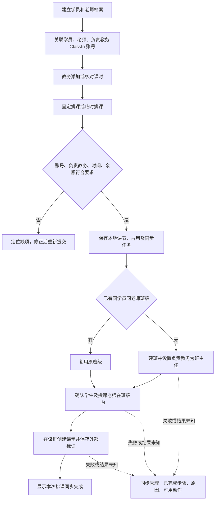

# ClassIn 排课与班级修改优化方案 V1.0

> 最新交互修订：页面反馈、自动重试和同步日志展示以[简化优化方案](ClassIn同步反馈与页面异常处理补充方案.md)为准。此前独立核实卡片、逐项重试和分步进度描述已被替代；新方案尚未完成实作验收。

日期：2026-11-20。状态：**本地核心流程已实施，自动化与隔离数据库检查已执行；完整验收及真实 ClassIn 联调未完成。**

当前实现、运行证据和逐项未验分支见[实施记录](ClassIn排课与班级实施记录.md)。下文“现状”保留为改造前基线，实际结果以实施记录为准。

2026-11-20 换师规则修订：用户明确选择简化为“取消原老师的固定占位及尚未上课的预约 → 结束当前排课关系 → 重新预约新老师”。本版已删除旧课原时间交接、保留 lessonId 跨班迁移等设计；下文为最新基线。

同日最终规则补充：教务交接后，新教务加入相关班级；能设置为 ClassIn 班主任则设置，确认不能设置时只加入班级也可完成交接。旧已预约课程保留原安排。学员更换 ClassIn 账号统一先取消该学员未上预约再重新排课：原账号仅该学员使用时剩余课时随其继承；原账号还有其他学员时余额全部留在原账号。收到 ClassIn 对已知课程的变更通知后自动同步，本地不再要求教务逐条确认正常改期或取消。

依据：本轮用户要求、上一会话的最终规则交接、当前工作区源码、当日核对的 ClassIn 官方接口文档。当前工作区包含大量未提交修改；实施时保留这些修改，不覆盖或回退。

配套：[产品功能地图](ClassIn排课与班级功能地图_V1.0.md) · [测试验收清单](ClassIn排课与班级验收清单_V1.0.md)。三份文档共用 `CI-xx` 功能编号、`AC-xx` 验收编号、`D-xx` 决策编号。

阅读约定：**已确认**是用户明确的业务规则；**现状**是源码核对结果；**设计建议**是为实现规则提出的具体做法，不代表已经开发；**待确认**只阻塞列出的相关能力，不阻塞其他工作。

## 1. 目标、范围与成功标准

让教务完成“关联人员账号 → 添加课时 → 排课”后，系统把课节放进正确的 ClassIn 班级，并且能说明是否真正同步成功、失败在哪一步、接下来怎样处理。

本方案覆盖账号、负责教务、班级、成员、排课、调课换师、取消、同步管理、外部变更、数据权限、旧数据兼容和验收。分阶段实施，但不能只交付“首次建班”便声称整个方案完成。

成功标准：

- 同一学员与同一老师的新规则课节共用一个班级；不同内部学员或不同老师分别建班。
- 学员、授课老师、负责教务在 ClassIn 中具有正确身份；新建班优先设置负责教务为班主任，交接时确认无法设置则保证新教务加入班级，并如实显示外部身份；额外成员不改变主讲人。
- 本地保存与外部同步分开显示；失败、部分完成、结果未知均不能误报成功。
- 重复提交、同组合多节课、任务中断恢复不产生第二个班级或重复课堂。
- 改期、换师、取消及交接不串改其他班级和课节；课时、考勤、权限沿用现有业务规则。
- 换号取消只影响换号学员，余额按账号归属处理，不复制、不按孩子平均拆分；历史课程扣返仍能定位原余额来源。
- 本地自动化、数据库集成、页面验收、真实 ClassIn 验收分别记录证据，不能相互替代。

本期不做：代注册界面、UID 手填入口、通用班群平台、多人合班、自动周期拆班、自动迁移所有历史课节、旧课直接换老师/跨班搬课、重写共享课时系统、全量拉取 ClassIn 历史数据、生产部署。真实外部写入另按明确的测试对象和授权范围执行。

## 2. 统一名词与确定规则

|名词|本方案含义|
|---|---|
|本地学员|`Student.id` 对应的业务学员，不能用手机号、姓名或 UID 替代|
|本地老师|`Teacher.id` 对应的老师档案|
|ClassIn 账号|外部登录身份，UID 是其用户标识；多个本地学员可以共用|
|班级|ClassIn course，保存 `courseId`；创建后有对应班级群|
|课节|本地 Lesson；外部课堂保存 `classId`，LMS 活动保存 `activityId`|
|教学计划|本地安排一批课节的组织方式，不是班级唯一键|
|负责教务|学员的业务负责人，目标用 `ownerAccountId` 指向团队账号|
|班主任|ClassIn `mainTeacherUid`；优先设置为负责教务，外部实际身份与本地负责人分别记录|
|账号课时余额|本系统以 ClassIn 账号为归属记录的剩余课时；不是宣称 ClassIn 平台代管本系统余额|
|额外成员|手动加入的教务、老师、TM；不自动成为主讲或班主任|

**已确认规则：**

1. 班级唯一组合是 `(studentId, teacherId)`，不包含教学计划、日期、姓名或 ClassIn UID。
2. 班级名为 `{学员中文名} {学员ID} - {老师英文名} 学习群`。
3. 同学员有 Alice、Bob 两位老师，就分别建立两个班级；后续对应课节进入对应班级。
4. A、B 共用同一个 ClassIn UID，也仍然有 A＋Alice、B＋Alice 两个班级。登录共享账号能看到多个已加入班级。
5. 教务与 TM 均需要支持账号关联。新建班按负责教务设置班主任；更换负责教务时，确认平台允许则变更班主任，明确不能变更则只加入班级。TM 不自动加入全部班级。
6. 手动加成员不改变班级归属，不改变负责教务，不改变已有课节的主讲人。
7. 保留当前“仅关联已有账号”的交互与获取 UID 逻辑；保留 UID 更换确认。
8. 添加课时、共享余额、占用、扣返及取消责任继续使用现有规则；本轮新增的换号余额去向按第 13 条执行，不另外设计收费规则。
9. 换老师统一结束所选原老师的当前排课关系：释放该组合固定课表占位、取消尚未开课的预约，再重新选择老师和时间预约；不要求沿用原日期，不把旧课直接改成新老师。
10. 换师只处理当前学员与所选原老师，不处理其他老师的安排、其他学员的占位或已上课程。旧预约保留取消记录，重新预约生成新的课节。
11. 更换负责教务时，学员及其课程当前管理归属转给新教务，相关班级让新教务加入；班主任设置按已确认的平台能力处理。授课老师、上课时间和课时余额不改变，原操作日志的处理人也不改写。
12. 系统升级前已约好的课程留在原班照常上；升级后新增预约才使用新班级规则，不批量搬迁旧未来课。
13. 学员换 ClassIn 账号：先取消该学员所有尚未开课的预约并释放其占位，再换绑、重新排课。若原账号仅该学员使用，剩余余额继承到目标账号；若原账号仍有其他学员，全部余额留在原账号，换号学员不自动带走余额。需要分配课时由有权限人员后续手动加减。
14. ClassIn 能通知的已知课程变更自动同步；已知课程改期、取消无需人工逐条批准。无法定位课程、字段不足或与班级归属冲突等实际异常保留外部事实并提示处理，不猜学员或费用责任。

**已经从代码确认，不需要再次询问的字段：**

- 学员业务 ID 就是现有 `student.id`：新建和迁移代码采用八位数字，列表、搜索和导出也使用它。使用规范化后的现有 ID，不新增另一套编号。依据：[studentIds.ts](../packages/shared/src/studentIds.ts)、[Students.tsx](../apps/admin/src/pages/Students.tsx)。
- 老师 `teacher.name` 在编辑界面明确标为“英文名”，可直接使用。学员取 `student.chineseName`，不能默默换成英文名。依据：[Teachers.tsx](../apps/admin/src/pages/operations/Teachers.tsx)、[model.ts](../packages/shared/src/model.ts)。
- 示例：`小明 10000001 - Alice 学习群`。历史缺中文名或 ID 未规范化的资料，应在相关排课前补齐；不猜姓名，不把 UID 填进班级名。

## 3. 现状与差距

|项目|当前代码行为|本次调整|
|---|---|---|
|学员、老师关联|已有手机号/邮箱关联表单；先加入机构，再取得已有账号 UID|保留并复用|
|教务、TM 关联|团队账号无 ClassIn 字段与入口|补字段、入口、权限和持久化|
|负责教务|`student.owner` 为姓名，组织范围、交接也依赖姓名|引入稳定账号关联，处理重名、改名与旧资料|
|建班|worker 每个 lesson 创建 course，名称为 `Crazy Talk + lesson.id`|新增班级实体，按学员＋老师复用|
|班级成员|仅添加学生；不设班主任、不显式加入课程教师|建立班主任、学生、授课老师三类必要关系|
|课堂映射|`ClassInLesson` 保存 courseId/classId/双方 UID|增加班级引用、activityId、外部操作状态；取消旧课保留原映射|
|排课前置|worker 仍要求 `teacher.phone` 非空|判断 ClassIn UID 与必要身份，不再用联系手机挡住已关联老师|
|签名|v2 客户端当前只支持标量 body|添加教师需要数组，按官方规则调整签名参与参数|
|换老师|按日期取学员所有未开始课节，直接更改 teacherId 并要求新老师覆盖旧时间|改为结束所选原老师的排课关系：取消固定占位和未上预约，再重新排课|
|同步|本地 outbox；worker 每 5 秒尝试处理；保留未知结果|扩展班级级任务及依赖；不承诺 5 秒完成|
|外部变更|支持进入、考勤、结束、评价、网络事件|增加班级、课节变动及冲突处理|
|统计|“总约课数”为筛选后的本地记录数量|明确口径，不能表示外部成功建课数|
|Demo|模拟关联返回值缺 `addedToInstitution`|与真实接口返回结构一致，保持模拟标识|
|共享账号拆出|现有绑定逻辑禁止已有共享余额的单个学员换号，且按整组关联/合并余额|新增用户明确要求的单学员换号流程；不能删除一条校验后继续套用原有整组搬移逻辑|

还有两处必须保留的业务联系：`student.bindClassIn` 当前会联动共享余额；`Student.teacherId` 仍表示主档案老师，而课节各自有 `teacherId`。班级归属以每节课的老师为准，不能从主档案老师推断全部课节。

现有学员 `groupName` 是单个历史资料字段，不能承担“一学员多个 ClassIn 班级”的名称存储；新班名保存在独立班级实体中，不覆盖原资料。本轮明确扩展共享组单个学员换号，范围只含用户指定的“余额留在原账号”规则，不做按比例拆分、自动补偿或整组一键换号。此前文档里的“共享成员不能单独改绑”是实现现状，不能继续作为本轮目标规则。

历史文档中的“密码/同意勾选后代注册”“换师只改原课节老师”等表述已经不适合作为本次目标。旧验收记录保留为历史证据；后续实施更新对应文档，不恢复这些旧交互。

## 4. 产品主流程

TM、额外教务或老师在班级建好后按需加入，不属于每次排课的必选人员。

### 4.1 页面与入口

|入口|目标体验|关联功能|
|---|---|---|
|学员详情 → ClassIn 账号|保留首次关联；换号预览该学员取消课程、原/新账号成员和余额去向，取消完成后改绑再重新排课|CI-01、CI-04|
|老师详情 → ClassIn 账号|关联现有账号；明确是否已关联，不要求联系手机必须有值|CI-01|
|设置 → 团队账号 → 教务/TM|显示关联状态、账号、UID；有管理权限者可关联|CI-02|
|学员资料 → 负责教务|按姓名＋队伍/组别选择，实际保存账号 ID；历史未匹配有明确提示|CI-03|
|学员详情 → ClassIn 班级（新增区域）|班级名、对应老师、班主任、成员、课节数、同步状态；可打开详情和添加成员|CI-05～CI-10|
|固定/临时排课面板|提交前显示将使用的班级名、“新建/复用”、班主任及缺项|CI-11、CI-12|
|课节详情/调课/换师|改期保留老师；换师先预览原老师的固定占位和待取消课程，取消完成后进入重新排课|CI-14～CI-17|
|设置 → ClassIn 同步管理|按班级/课节定位，显示具体步骤、原因、结果未知和下一步动作|CI-18～CI-20|
|上课记录|本地记录口径、同步状态、取消同步结果与班级关联|CI-21|
|同步管理 → 外部变更|查看收到的变动、匹配对象、差异、处理结果和待核实事项|CI-22、CI-23|

不新增一级“班级管理中心”，优先在已有学员详情和同步管理中完成闭环。

## 5. 分模块规格

### 5.1 人员账号与负责教务（CI-01～CI-04）

用户故事：作为教务，我希望人员关联后就能排课，并清楚知道缺的是哪一个人的账号。

- 学员与老师继续复用 `ClassInLinkForm`。教务/TM 也使用同一能力，但显示业务角色名称；在 ClassIn 侧按机构教师加入，不创建授课老师档案、不修改本地角色、不授予 ClassIn 后台管理员身份。
- 关联入口只输入手机号/邮箱。保持当前提示：“请填写已注册的 ClassIn 手机号或邮箱，并核对账号是否正确。关联成功后，该账号将加入本机构。”
- 前一步返回未注册 113 时结束；机构加入返回 1/133 后取已有账号 UID，register 只接受 135/461。取得 UID 且本地保存成功才显示关联成功；保存失败复用本次结果重新保存。不得使用 addTeacher 返回的机构关系 ID 作为 UID。[注册用户](https://docs.eeo.cn/api/zh-hans/user/register.html)、[添加老师](https://docs.eeo.cn/api/zh-hans/user/addTeacher.html)。
- register 仍是具有注册能力的接口；现有逻辑通过先确认账号存在来使用它，不将其描述为纯查询，也不声称不存在竞态。本次保留该调用逻辑，不新增代注册流程。
- 新增团队账号关联时，服务端必须依据目标团队账号和 `account.manage` 权限判断，不能为了复用接口给教务/TM 额外开放 `teacher.edit`。关联请求新增目标类型及目标 ID，先校验可操作对象，再产生外部机构成员变更。
- 目标字段：团队账号的 `classInAccount`、`classInUid`；学员的 `ownerAccountId`。现有姓名字段可继续作展示/导入原文，但不再作为已关联学员的班主任身份依据。
- 旧教务资料只在“姓名＋已有组织资料能够唯一匹配”的情况下建立 ID 对应；零匹配或多匹配列为待分配，由管理员选择。禁止取重名账号中的第一条。
- 已确认的负责人使用账号 ID 贯穿资料保存、组织过滤、队组权限和交接。导入/未分配历史资料保留现有来源组织信息，不因本次增加字段而突然扩大或收窄其他历史学员可见范围。
- 学员 UID 更换按下列已确认流程执行，不沿用旧的整组换绑限制，也不把现有课堂改用新账号。本轮用户决定针对学员，不据此扩张老师、教务、TM 自身 UID 的批量改换能力；这些身份继续原有关联边界。

#### 学员换号、取消与课时归属（CI-04）

**账号识别：**以外部 UID 判断是否换身份。只是手机号/邮箱更新且 UID 相同，不取消课程、不搬余额。课时在本系统以 ClassIn 账号为归属存储，换号不调用平台接口去转移本地课时。

|原账号成员|换号前剩余余额示例|A 换到新独立账号后|原账号安排|
|---|---|---|---|
|只有 A|20 课时|A 继承 20；原账号剩余为 0|取消 A 的未上预约，保留历史记录|
|A、B|20 课时|A 不带走余额，新独立账号为 0|20 课时全部留原账号由 B 使用；只取消 A 的预约|
|A、B、C|20 课时|A 不带走余额，新独立账号为 0|20 课时仍由留下的 B、C 共用，不给 B、C 各复制一份|

若目标账号本来已有余额，该余额保留：共享账号拆出的 A 带入 0，但可按目标账号既有共享规则使用目标余额；原账号仅 A 时，将其剩余余额加到目标已有余额一次。改绑预览必须说明目标已有成员，不能把目标余额清零或误当 A 搬来的余额。

1. **核实新账号并预览。** 复用现有“仅关联已有账号”查验；显示原账号成员、目标账号成员、只属于 A 的待取消课节（跨全部授课老师）、预约占用、原/目标余额变动。新账号核实失败时不取消任何预约。
2. **取消 A 的原预约。** 记录换号操作及目标账号，取消 A 所有尚未开课预约、释放 A 对应固定占位/锁定，逐节取消外部课堂；B、C 的课节、占位、老师及教务归属不动。ClassIn 取消失败或未知时保留当前绑定及余额归属，显示处理中，先解决取消结果。
3. **取消确认后原子改绑和记账。** 在一次本地事务内更新 A 的账号归属、当前受益成员和按上表规定的余额去向；重读原账号成员/余额再决定“独享继承”或“共享留下”，防止处理期间其他学员加入、退出或消费后仍使用旧快照。请求重复只产生一次绑定和余额结果。
4. **共享拆出不产生课时转账。** 从原账号当前成员/余额受益关系中移除 A，剩余余额原地保留。B 的已约占用继续保留；A 取消仅释放原账号的预约占用，不额外增加余额。例：原余额 20，A 占用 2、B 占用 4，原可用 14；A 离开后原余额仍 20，B 占用仍 4，可用变为 16，A 新空账号为 0。
5. **独享换号只继承一次剩余余额。** 原账号剩余转出、目标账号转入须成对可追溯，总余额守恒，不产生新的购课收入/赠送记录；已有历史消费不搬家。复用既有余额来源和流水结构，不能通过复制整个账户订单制造双份余额。
6. **班级按内部学员 ID 保留，替换 A 班内的学生账号。** A 的原未上课堂已取消；在 A 各班中确认加入新 UID、移除旧 UID，成功后才创建 A 的新课堂。共享旧账号仍保留在 B、C 各自班级，不能删除整个机构账号或按 UID 批量退所有班。必要成员变更失败时显示“账号已改绑，班级成员待同步”，不虚报可上课；也不能为了回滚外部失败反复移动余额。
7. **历史按原课节的余额来源处理。** 旧课的 orderId/原账号、旧 UID、购买人和购课时成员快照不改写；历史扣返仍追到原余额来源，不根据 A 当前 UID 记到新账号。ClassIn 历史回放访问是否受成员移除影响在联调中记录，不承诺原账号继续访问 A 历史课堂；本地历史始终保留。
8. **重新排课与手动调整。** 改绑及班级必要成员处理完成后走正常排课；目标可用课时不足则按现有规则加课时后再约。共享拆出后的补分配通过既有手动加减、权限和原因记录完成，不自动平均分、不按 A 旧预约数量分配余额。

取消旧课与本地改绑不能作为跨系统原子事务；本地成员/余额事务必须原子，外部步骤结果按阶段持久化。仅允许有权操作受影响原/目标共享账户成员及余额的人员完成改绑，不能通过换号绕开当前共享账户权限检查。

### 5.2 班级建立、名称与查看（CI-05～CI-08）

用户故事：作为教务，我希望同一个孩子与同一位老师持续使用同一个学习群，且能一眼分清共用账号的孩子。

- 首次实际排课才创建班级；建档、关联账号和加课时不自动建班。
- 查找或创建 `(studentId, teacherId)` 记录，数据库唯一约束保证一对一；名称只是显示字段。
- 创建外部课程时传 `mainTeacherUid=负责教务 UID`。外部 courseId 一旦取得就保存，之后成员或建课堂失败也不丢失。[创建课程](https://docs.eeo.cn/api/zh-hans/classroom/addCourse.html)。
- 学员加入课程；授课老师加入课程教师；班主任已经通过 mainTeacherUid 设置，不为同一 UID 重复添加教师。其他角色按 UID 避免重复外部成员操作，但不按 UID 合并业务班级。
- 必要成员未确认成功时不开始创建课堂。教师接口必须逐个检查返回结果；停用、非机构教师等错误明确显示，不把外层成功当全部成功。[添加课程教师](https://docs.eeo.cn/api/zh-hans/classroom/addCourseTeacher.html)。
- 创建名称上限 90 字，编辑上限 40 字；按具体操作在边界校验，禁止静默截断或删掉业务 ID。是否统一限制及更名同步见 D-05。[创建课程](https://docs.eeo.cn/api/zh-hans/classroom/addCourse.html)、[编辑课程](https://docs.eeo.cn/api/zh-hans/classroom/editCourse.html)。
- 详情展示本地归属与外部 courseId、已确认成员和待同步成员、当前班主任/待变更班主任、关联课节与最近错误。没有班级时显示“首次排课后自动创建”。
- 同班追加只创建课堂；教学计划结束或取消最后一节课不结束/删除班级。
- 班级被外部结束/删除或达到限制时，显示异常并停止该班新增课堂；不悄悄建立第二班。容量及恢复策略见 D-08。

### 5.3 手动成员与班主任交接（CI-09、CI-10）

用户故事：作为有权限的教务，我希望将协作老师、教务或 TM 加入具体班级，并能看见是否加入成功。

- 班级详情的“添加成员”选择系统中有权使用且已关联的人员；未关联者说明缺项并提供有权限的关联入口。候选列表与提交接口都限制数据范围。
- 本期支持添加，不扩展自由踢人、解散班级或聊天权限配置。说明这些人在 ClassIn 中按课程教师加入，不承诺仅聊天权限。
- 请求后显示该成员“处理中/已加入/失败/待核实”；已加入成员不能再次提交。额外成员失败不将已有正常课堂改成建课失败，但班级详情必须显示未完成事项。
- 更换负责教务的核心行为已确认：学员及其课程当前管理归属转给 B；B 必须加入相关 ClassIn 班级，能成为班主任则设置，明确不能成为班主任则只加入班级。课程继续原时间、原授课老师上课，不取消、不重新预约，不重建群或课堂；历史操作人和处理记录不变。
- 官方 `editCourse` 的 `mainTeacherUid` 支持修改班主任，因此文档层面有实现途径；当前机构和 B 的实际资格仍需联调确认。使用既有教务 UID，不能将本地业务角色“教务”误解为平台必须有相同名称的身份。[编辑课程](https://docs.eeo.cn/api/zh-hans/classroom/editCourse.html)。
- 交接预览包括新规则班级及旧课映射可定位的 courseId，按 courseId 去重，校验 B 已关联。逐班尝试可用的班主任变更；明确不支持或 B 不符合班主任条件时，按用户允许的方式将 B 作为课程教师加入。成员接口也需确认 B 的单项结果，不能外层成功即视为加入。[添加课程教师](https://docs.eeo.cn/api/zh-hans/classroom/addCourseTeacher.html)。
- 这是用户明确要求的两种业务结果，不是把任意接口失败都忽略：网络超时、结果未知、凭证错误不能直接宣称“不支持班主任”并完成交接。保留实际状态，按未知结果核实；若 B 连班级成员也未加入成功，该班交接仍未完成。已结束/已删除班级单列，不擅自恢复或重建。
- 本地负责人和外部实际班主任分别展示。某班可以显示“负责教务 B；ClassIn 班主任 A；B 已加入班级，班主任未变更（原因）”。此为已确认不支持变更后的允许结果，不能因为两人不同永久挡住后续排课；B 尚未加入或结果未知时继续等待。多班显示每班结果及 X/Y 完成数。
- 原教务 A 失去本地负责人的身份，不保证其外部班主任一定已替换：仅成员加入模式下外部身份可能维持原状。若变更班主任成功，A 是否留作普通成员仍属于独立成员处理；本期不增加自动清退作为交接前提，实际状态如实记录。修改班主任时 `stamp` 的选择需在实现说明中明确，不混同本地负责人权限。

### 5.4 固定/临时排课与同步（CI-11～CI-13）

用户故事：作为教务，我希望排完一批课后，知道哪些已放进正确班级，哪些需要处理。

1. 两种排课入口及课程计划追加使用同一业务提交路径。保留现有时段、师生冲突、训练/状态限制、锁和余额检查。
2. **设计建议：**提交前集中检查学员 UID、每位目标老师 UID、有效负责教务及其 UID、命名所需资料。缺失时整笔排课不落库、不占课时，说明具体人员及修正入口；不要求联系手机非空，不检查无关 TM。后端在命令边界复核，内部函数不层层重复。
3. 同一事务保存本地课节、课时占用和 outbox。界面提示“本地排课已保存，等待 ClassIn 同步”，外部失败不回滚已提交的其他业务记录。
4. worker 按组合找到班级，完成必要成员关系，再创建课堂。创建采用当前已发布课堂能力，指定 teacherUid，1v1 沿用 seatNum=2；保存 courseId/classId/activityId。[创建课堂](https://docs.eeo.cn/api/zh-hans/LMS/createClassroom.html)。
5. 先加入班级再创建课堂的正常路径，不增加逐节加学生请求。[添加活动成员](https://docs.eeo.cn/api/zh-hans/LMS/addStudent.html)。学员换号先取消原预约，再替换 A 班成员并正常新建课堂，不改原课堂学生 UID。
6. 一批课可能部分成功，逐节显示结果及汇总，重试只处理未完成步骤。加班级教师、设置班主任等班级操作不得按课节重复执行。
7. 稳定唯一标识覆盖重复提交和响应丢失。建班唯一标识基于固定业务组合；课堂唯一标识基于本地 lessonId。换师取消后重新预约产生新 lessonId，沿用正常建课逻辑；同一课节重试不得更换标识。不引入为跨班搬课服务的创建轮次。
8. 当前 worker 已串行执行，复用该机制；不引入新的消息队列、多 worker 架构或自动重试平台。

### 5.5 改期、换师、取消与停课（CI-14～CI-17）

|动作|班级和课堂变化|课时与本地身份|
|---|---|---|
|仅改期|原班、原课堂修改时间；不新建班级|保留 lessonId，沿用原冲突与占用逻辑|
|换老师：取消原关系|选择原老师，预览并取消该组合固定占位与所有尚未开课的预约；ClassIn 逐节取消|保留旧 lessonId、原老师、取消原因和映射；解除当前排课关联；其他老师不受影响|
|换老师：重新预约|取消完成后复用已有匹配和排课页面，重新选老师、日期、时间；按新组合找或建班|生成新 lessonId 和新课堂，重新计算占用；不要求与原课时间、数量一一对应|
|取消一节|仅取消该外部课堂，不删除 course 或成员|沿用现有取消原因、责任、扣返与核实待办|
|停课/结课/退款服务停用|对现有规则选中的未来课节分别取消|保留现有共享账户范围和流水；不解散所有班级|
|复课|允许重新排课；同组合可复用原可用班级|不恢复已取消课堂，不额外加课时|

**换师统一流程（用户已确认取消后重新预约；不保留“原时间直接交接”分支）：**

1. **选择结束哪位老师的关系。** 在学员档案选择原老师，列出该组合固定占位、临时锁定和所有尚未开课的预约；展示将释放的预约课时以及已有取消规则需核实的事项。其他老师的课程单独标明不在本次范围。此时不要求已经找到新老师，也不要求新老师能覆盖旧时间。
2. **确认取消原安排。** 用一次本地事务取消范围内预约、释放该学员在原老师处的占位和预约课时、结束当前排课关联，并保存逐课 ClassIn 取消任务和操作事件。确认前退出无变化；已执行后暂时不找新老师是允许状态，不自动恢复旧课。
3. **取消固定占位必须处理真实来源。** 当前固定课来自已排 Lesson、`slotLocks` 及排课页面草稿，不假设已有独立的长期固定计划表。只清理该学员＋原老师的相关占位/草稿选择，保留学员上课意向和老师本人的可上课时间。现有 `slot.release` 会释放该学员全部锁定，不能原样用于多老师换师；应限定 teacherId。旧页面草稿重新提交时需要显示当前关系已取消，不能静默恢复旧安排。
4. **结束的是当前排课关系。** 若 `Student.teacherId` 指向所选原老师，清除当前老师引用和对应展示；不自动拿另一位老师替上。其他老师已排课程照常，学员不因此停课/退费；界面可显示“待重新排课”。保留原老师档案、ClassIn 账号、历史课程和班级映射，不退群、不解散班级，也不永久禁止以后重新预约同一老师。
5. **确认旧课外部取消。** 无外部创建尝试的预约可以直接完成；已存在的课堂逐节取消。部分失败只重试失败课，结果未知先核实；显示“本地已取消，ClassIn 取消完成 X/Y”。本次重新预约在相关旧课堂取消确认前不能提交；其他已有课程不受影响。外部取消未确认的旧时段保留未完成提示和必要的冲突限制，不能显示两端都已空闲。
6. **重新预约新老师。** 取消完成后点击“重新排课”，只带入学员及既有上课意向，重新选择老师、日期、时间与课次数量。复用正常匹配、时段校验和余额校验，不预填旧课程作为必须承接的排期。新课生成新 lessonId，按学员＋新老师组合找或建班；新老师从未合作则新建，已有该组合班级则复用。
7. **区分占用与实扣。** 尚未实际扣除的预约课时随取消释放，重新预约再占用；不把释放占用变成额外赠送或再次返还。已有扣课、临近开课责任等异常继续按现有取消核实规则，不自动承诺免扣或退款。新旧两次操作都保留记录，不通过改单抹去原安排。
8. **失败与中断。** 旧课取消成功而新课未约成时，保持待重新排课，不自动复活旧课；新预约保存或同步失败按正常排课的失败路径处理。取消动作重复提交不重复释放课时，重新预约重复提交不重复建课。由旧课堂到达的回调仍关联旧取消记录，不能影响新的课节。

仅改时间继续使用原老师的调课功能。所有老师变更入口，包括现有调课表单的老师选择，都应引导到上述取消关系→重新预约流程；本期不新增单节保留 ID 的临时代课/跨班迁移能力。

普通改期继续复用已接入的修改接口；临近开课限制与外部拒绝应显示实际原因。旧修改接口仍可用但不再更新，本次不为此强制重写所有旧接口。[修改课节](https://docs.eeo.cn/api/zh-hans/classroom/editCourseClass.html)。取消只作用于指定课节，平台拒绝或结果未知时本地取消与外部取消分开展示。[删除课节](https://docs.eeo.cn/api/zh-hans/classroom/delCourseClass.html)。

另外，已有 `lesson.link` 可以重新关联课节的本地学员。实施时检查该调用方，不能借此绕过班级组合：尚无外部课堂的待关联记录按原权限处理；已有外部映射的课节不允许直接改学生后换原班成员，需取消后按正确学员重新预约。本期不为该入口引入跨班迁移能力。

### 5.6 同步状态、重试和未知结果（CI-18～CI-21）

课节业务状态、同步操作状态、班级成员状态分开，不组合成几十种新课节状态。

|显示状态|含义|允许动作|
|---|---|---|
|待同步/处理中|任务已保存，尚未确认外部操作完成|查看进度，避免重复提交|
|已同步|最近目标操作成功且对应必要步骤完成|查看该课节映射；旧预约取消成功不代表外部仍有有效课堂|
|同步失败|已知明确失败，展示失败步骤与原因|修正问题，显式重试该步骤|
|待核实|请求发出但结果不确定，或外部与本地存在冲突|核实外部标识/状态；不能普通一键重建|
|等待前置处理|同班或同课节有尚未解决的依赖|跳转前置事项，不反复请求|
|未接入/历史未核验|没有足够的外部映射证据|显示来源，不计算成外部确认成功|

- 班级任务影响该班后续课节；单一课堂未知只阻塞该课节后续变更，无关班级继续执行。
- 班级建立可以在官方已说明的唯一标识契约下恢复原 courseId；课堂 uniqueIdentity 不能被推断为可读回 classId/activityId。后者须有确证的映射或人工核实流程（D-09）。
- 最小核实流程：有权限者查看原操作及步骤，记录外部 courseId/classId/activityId 和当前状态、核实依据；服务端检查本地归属及映射是否冲突，确认后从未完成步骤继续。人工确认应标“人工核实”，不能伪称 API 自动验证。
- 旧任务完成不得覆盖更新后的目标状态；关联旧目标的成功结果仍记日志，只在其仍是当前目标时更新页面“已同步”。
- 本地取消释放的时段在外部取消未完成时可能仍有占用；保留外部未完成提示及相关时段限制，不能让页面称两端均已空闲。换师按第 5.5 节先确认取消再提交新预约，不因本地占用已释放就跳过外部取消结果。
- 上课记录把“总约课数”明确为“本地约课记录”，解释含取消/同步失败。同步成功数表示最新操作已成功，不是 ClassIn 当前有效课堂数。若展示“有效课堂数”，必须限定为已确认有效映射、排除已取消/已替换且注明最后确认时间。
- 列表、汇总、跳转详情及导出（若已有该字段）使用同一权限和筛选口径。没收到外部变更前不能宣称实时全量一致。

### 5.7 外部变更、考勤与冲突（CI-22～CI-24）

用户故事：作为教务，我希望有人在 ClassIn 修改或取消课堂时，本系统收到通知就同步更新，避免继续按旧课表安排。

- 复用 webhook 验签、入箱和去重，按 Cmd 分开解析；新事件使用 `CourseId`，不能强套现有 `CourseID`/必有 ClassID 的考勤 schema。
- `eeoCourseInfoChange` 接收班名、班主任、课程状态变化；`eeoClassInfoChange` 接收课节新增、修改、删除；相关成员事件按实际订阅能力接入。
- `opSource=3` 同时包含后台、客户端和 LMS API，不能只凭它判断是“他人修改”还是本系统回声。结合映射、正在执行的操作、目标字段和事件时间识别；不能确认的变动进入待核实。
- 平台文档提供变动消息，但旧建班文档又有客户端不回传的说明，真实覆盖需订阅联调确认。不能据文档推导历史全量回填能力。[排课信息同步消息](https://docs.eeo.cn/api/zh-hans/datasub/ClassInfo.html)、[订阅说明](https://docs.eeo.cn/api/zh-hans/datasub/description.html)。
- 用户已选择收到通知后自动同步。接入时需要配置并验证机构的排课变更订阅和可达回调地址；当前代码只处理部分考勤/课后事件，不表示排课变更已经接通。用真实测试课在 ClassIn 后台改时间和取消各验证一次，另记录客户端覆盖情况。

**已确认自动同步，按以下正常路径和明确异常执行：**

|收到的变化|自动同步与异常处理|必须防止的错误|
|---|---|---|
|当前已知课节被外部取消|核对映射及回声后自动更新本地取消状态、释放预约占用并记操作来源；费用责任缺失仅把扣返事项交原有核实流程，不阻塞取消事实同步|只改状态却遗漏占用，猜扣费，或要求教务再点一次同意取消|
|同归属已知课节外部改期|自动同步新日期/时间/时长及占用；若与其他预约冲突，同时标冲突并提示处理，不能因本地排课校验拒绝而继续显示旧时间|旧消息覆盖较新安排，默默取消另一节课，或把冲突藏起来|
|外部改老师或改学生|自动记录外部实际值；能唯一识别且符合既定归属的变动自动更新；违反学员＋老师班级组合或共享 UID 不能唯一定位时标归属冲突，不猜对象、不自动搬班|用 UID 推断唯一学员，或把 A＋Alice 班的内部归属静默改成 B＋Bob|
|外部新增未知课堂|保存待关联记录，给出班级与事件信息；补齐本地业务信息后再导入|仅凭相同 UID 自动创建本地课并占用/扣课|
|班名/班主任/成员变化|自动同步外部事实；本地负责教务仍由本系统分配，不能据外部班主任改动擅自转移学员归属；必要成员被移除或归属异常时提示处理|把外部班主任与本地教务强制当成同一字段，或与客户端反复互相覆盖|
|班级结束/删除|标记不可继续建课，关联未来课节逐项核实|假装都已取消，或自动建第二班|

- 重复事件不重复调整流水；晚到事件不得覆盖已确认的新版本；无法判定先后时保留冲突，不增加无依据重试。
- 外部事实同步不是再次发起同一写请求：不把回调产生的本地更新又作为 outbox 改课推回 ClassIn。内部排课仍拒绝冲突；外部同步要保存已经发生的变化并标识冲突，两者不能不加区分地调用同一个拒绝冲突入口。
- 待核实事件保留本地计划与已知外部事实两份信息。未处理前不能显示两端一致；涉及时间冲突时，排课检查也应考虑已知外部占用，而不是只显示提示后继续安排冲突课。
- 通过 `courseId + classId` 映射到课节，再核对该映射的学生/老师 UID。共享 UID 的两个孩子必须分别入各自课节；额外教务/TM 的进入事件不计为学生或主讲出勤。
- 旧取消记录的映射、取消回声、未知课堂事件不进入新预约课节的自动扣课。正常当前课堂继续沿用既有考勤、确认、自动结算和更正路径。

### 5.8 权限、存量及 Demo（CI-25～CI-27）

- 采用“已有动作权限＋目标学员/老师/账号范围”，不因加入 ClassIn 班级就扩大本系统数据权限。
- 查看班级依赖学员/课节可见范围；手动添加成员建议使用新增细粒度 `classin_class.manage`，并限制目标班级与候选人员。角色默认分配见 D-10。
- 团队账号关联使用 `account.manage`；学员/老师关联保留现有各自权限；同步重试用 `sync.retry`，核实动作也必须限制对象范围。UID/手机号按现有敏感字段可见规则返回。
- 负责教务 ID 改造影响组织过滤、账号改名、停用交接，必须一并迁移实际调用方。团队账号业务数据当前在 `TeamAccount.data`；登录 `Account` 是另一张表，不重复存两份可独立修改的 UID。
- 存量规则已确认：旧映射原样保留并标记“旧规则”，已约课程留原班上课；新增预约使用新班级。旧课正常改期/取消仍使用原映射；换师或学员换号按各自流程取消旧预约，重新预约时才按新规则建课。本期不做系统升级导致的批量搬课。
- `activityId` 对历史课允许缺失，不伪造；旧取消/改期路径需要的已有标识仍可用。
- Demo 采用相同产品字段、状态和功能路径，外部调用完全模拟；修复关联接口结构，并在页面标识模拟。Demo 成功不能替代业务 API 和真实 ClassIn 验收。

## 6. 最小技术改造设计

以下是可直接拆任务的设计建议；不新增通用事件总线、配置中心或微服务。

### 6.1 数据与持久化

|对象|最小新增/变更|约束与用途|
|---|---|---|
|团队账号业务模型|`classInAccount?`、`classInUid?`|教务/TM 身份关联；复用 `TeamAccount.data`，登录账号不重复保存|
|Student|`ownerAccountId?`|指向团队账号；旧数据回填后，新排课要求有效关联；展示名不是身份键|
|ClassInAccount 与课时来源|已有本地账号对象；为其余额来源建立明确的账号引用，复用现有订单/流水|课时按账号归属；当前 studentIds 是受益关系，不能用历史成员并集把已拆出的 A 自动重新合回旧账号|
|ClassInClass（新增）|id、studentId、teacherId、ownerAccountId、courseId?、name、已确认班主任 UID、同步状态/错误|唯一 `(studentId, teacherId)`；courseId 有值时唯一|
|ClassInClassMember（新增）|classLocalId、人员类型/本地 ID、UID、加入结果、错误|记录必要与额外成员；同班同 UID 外部加入不重复，保留内部角色来源|
|ClassInLesson（扩展）|classLocalId?、activityId?、外部状态；保留现有标识与 UID|一课一映射；旧取消课与新预约各有独立 lessonId，原映射原地保留；courseId＋classId 不得指向两节本地课|
|ClassInJob（扩展）|班级级或课节级目标、操作、目标版本/顺序、阶段及必要快照|班级任务不伪造 lessonId；换师只需取消任务及其操作来源，新预约使用正常创建任务|
|ClassInWebhook（复用）|补充处理结论及关联对象所需信息|原始事件、去重、待关联/冲突、人工核实结果可追溯|

学员换号记录最少需包含来源账号、目标 UID、操作学员、取消任务来源及处理阶段，可复用现有事件/任务持久化；不另建通用迁移平台。未绑定学员仍沿用现有购课能力；历史余额来源账号只能确定时回填，不能因引入账号引用猜测历史归属。

班级表与任务表由 API 持久化并输出受权限约束的 DTO，不直接作为可由客户端任意替换的整库 JSON。`store.ts` 当前会把未列入 collections 的状态字段写入 BusinessSettings；新增只读班级 DTO 必须明确排除，不能意外写入该配置表。

换师简化后，不新增 `ClassInLessonHistory`、课堂创建轮次或旧课堂迁往目标班的中间映射。取消历史由原 Lesson/原 ClassInLesson 保存，操作批次关联复用现有事件和任务来源信息即可。

数据库升级顺序：新增兼容字段/表 → 唯一可匹配负责人回填和未匹配清单 → 开通新写入路径 → 新课走新规则。旧课映射不得因为班级表为空而重新创建。迁移脚本可重复运行，已确认映射不覆盖；在隔离数据库验证后再讨论实际环境应用。

### 6.2 服务和接口

|位置|具体改动|
|---|---|
|`packages/shared/src/model.ts`、`commandSchema.ts`、`domain.ts`|账号、负责人、班级 DTO/命令；将换师改为按原老师取消关系，定向释放占位/预约；不改现有收费计算|
|`organization.ts`、`access.ts`|负责人 ID 解析、实际范围调用方、班级/成员/团队账号操作权限|
|`studentIds.ts`、导入链路|规范化后的学员 ID 贯穿新增班级引用；迁移执行先后有测试|
|`apps/api/prisma/schema.prisma`、迁移、`store.ts`|新增班级与成员、扩展原课节映射和任务类型，明确查询 DTO 与持久化边界|
|`classin.controller.ts`|关联目标类型及目标 ID 的权限校验；复用既有账号调用|
|`classin.ts`|建班传班主任、编辑班主任、添加教师、返回 activityId；v2 数组签名及成员结果解析|
|`controllers.ts`、`outbox.ts`|资料/排课事务触发正确任务，班级成员或班主任变化不依赖“刚好有一节课变动”|
|`worker.ts`|按班级复用、步骤恢复、取消结果汇总、当前目标防覆盖；保留串行调度，不实施跨班搬课|
|`webhook-events.ts`、`webhook-replay.ts`|分事件 schema、ClassInfo、当前/历史映射、回声及冲突处理|
|`refund-sync.ts`、结算调用链|保持现有退款外部取消汇总；防止历史/未核实事件进入当前扣课|
|学员/老师/设置/排课/课节/同步页面|按功能地图接入字段、预览、状态、成员、处理入口|
|`StudentActions.tsx`、固定排课/课程计划页面、锁定调用方|换师先取消关系再重新排课；失效的原老师草稿不可静默提交；调课入口不能绕过新换师流程|
|`StudentClassIn.tsx`、`packageBalances.ts`、共享订单/扣返调用方、`student.bindClassIn`|增加明确的单学员换号流程和余额去向预览；拆出时不调用整组搬移/余额合并；独享剩余继承与历史来源可追溯；保留首次关联获取 UID 协议|
|`apps/admin/classInLookup.ts`|Demo 接口结构与模拟状态一致|

沿用现有 `/api/state` 与显式 `/api/commands` 风格，新增班级查询数据及少量成员/核实命令，不顺便重做全站 REST 接口。新命令在实现时确定名称，但必须携带目标实体 ID、请求 ID，服务端取操作者。

添加课程教师需要 `teacherUids` 数组；v2 签名排除数组/对象及官方规定的超长值，仍完整发送请求 body。当前签名只有标量支持，不能只把类型改宽便认为完成。[v2 签名规则](https://docs.eeo.cn/api/zh-hans/appendix/signature.html)。

### 6.3 记录与诊断

复用现有业务事件、同步任务和回调记录，记录操作者、目标对象、原/目标安排、外部标识、失败步骤、人工核实依据。页面能从一节课找到对应班级与失败原因即可，不增加一套独立埋点平台；日志不保存密钥、随机密码参数或完整敏感凭证。

## 7. 实施批次与交付门槛

|批次|交付内容|进入下一批的标准|
|---|---|---|
|M0 规格核对|确认影响目标行为的 D 项，留存存量盘点和权限选择|决策有记录；尚未确定项明确隔离，不能写成已确认|
|M1 人员与负责人|CI-01～CI-03、CI-25 的账号/负责人部分、CI-27 的关联协议|四类人员可关联；重名负责人不误配；保存重读和队组权限通过|
|M2 班级与正常排课|CI-05～CI-08、CI-11～CI-14、CI-17～CI-21、CI-26 基础兼容|同组合复用、共享 UID 分班、成员/课堂失败可见、单节取消不伤班级|
|M3 成员和变更闭环|CI-04、CI-09、CI-10、CI-15、CI-16；换师/换号取消后重约、账号余额归属、教务加入/班主任两种结果|独享余额继承、共享拆出余额留下、B 预约不动、历史扣返、成员和交接专项通过；不得只测新建班|
|M4 外部同步与整体验收|CI-22～CI-24、CI-28；完成 Demo 和文档对齐|外部事件规则验证；真实测试范围逐项有结果，缺外部条件明确标阻塞|

M2 是开发检查点，不是完整发布版本。已有换师等入口必须随 M3 完成正确行为后才能按整套方案验收；普通开发不执行部署。

各批只运行本次受影响专项。模块整体结束时执行下文验收清单的完整 ClassIn 业务链与受影响模块检查；不自动扩大到无关薪资、问卷等全项目回归。测试结果、提交/工作区版本、未通过项统一记录在验收清单。

本轮新增换号余额规则会直接影响 `packageBalances`、共享订单受益关系、预约占用、历史扣返及共享账户权限，M3 应增加这些模块的专项验证；原因是 A 拆出后不能被旧成员关系重新合并，也不能使 B 的占用或余额改变。仍不据此默认执行全站回归。

## 8. 决策与外部依赖登记

标记“已确定”的项目按最新用户规则执行，不再次询问；其余项目尚待确认或需要外部证据。实施到对应能力前确定，其他独立功能可先进行。

|编号|问题|建议|影响/确认时点|
|---|---|---|---|
|D-01（已确定，能力待联调）|小明从教务 A 转给 B 后，B 能否担任外部班主任？|本地归 B；ClassIn 明确支持则设 B 为班主任，明确不能则 B 仅加入班级。文档有修改班主任接口，但当前机构需联调；结果未知不伪称不支持|CI-10；两种允许结果均可实现和验收，不因无法换班主任否定已确认入班的交接|
|D-02（已确定）|升级前已经约好的课怎么处理？|保持原班、原课堂照常上；新增预约采用新班级规则，不为本次升级批量搬课|CI-26；用户已采纳建议，不再阻塞 M2|
|D-03（已确定主流程）|换师时旧课取消与新预约的先后关系|用户已确定先取消原关系，再重新预约；实现上区分本地取消与外部确认，完成前不提交本次新预约；新预约失败保持待排，不恢复旧课|CI-15/16/17/18；按第 5.5 节实现，不再开发原时间直接交接|
|D-04（已确定，推送待联调）|收到 ClassIn 外部改课通知后怎么办？|自动同步已知课程改期、取消及可识别字段；只将未知映射、归属冲突、费用责任等异常留待处理，不要求逐条批准正常变更|CI-22/23；文档有排课变更通知，需配置机构订阅并验证投递；接通前不得声称已自动同步|
|D-05（实施选择已落定）|姓名变化是否改历史班名；长度是否统一 40 字？|初建按明确格式；资料改名不自动批量改群名，先保留创建时名称；确需改名再单独明确|CI-06；不影响正常长度的首次建班|
|D-06（已确定）|A 换 ClassIn 账号，预约和课时怎么处理？|取消 A 未上预约再重约；原账号仅 A 时剩余余额继承；原账号有 B 留下时全部余额留原账号给 B，A 带出 0；后续需要分配则手动加减|CI-04；覆盖旧“共享组单人不可换号”目标限制；B 的预约不取消，历史记录不改写|
|D-07（已确定）|换老师处理范围与是否重新排时间|结束当前学员＋所选原老师的关系，取消其固定占位及所有尚未开课预约；其他老师不受影响；每次重新选择老师和时间预约，不设旧课直接交接分支|CI-15/16；M3，已由用户本轮明确|
|D-08|班级容量/单元容量、已结束班级如何继续？|先确认机构真实限制和可用操作，不以周期自动拆班绕开组合唯一规则|CI-05/12；长期复用真实验收的外部依赖|
|D-09（人工核实已实现）|未知课堂结果如何取得可信标识和当前状态？|确认平台可用查询能力；没有则按限定人工核实流程恢复，不伪造自动恢复|CI-20；自动恢复的外部依赖，未知状态保留可开发|
|D-10（实施选择已落定）|“添加班级成员”按钮由谁使用？例如教务能否自己把另一位老师或 TM 加进指定班级？|沿用现有权限：lesson.view 查看、student.reschedule 添加成员、sync.retry 恢复异常；TM 可以被加入，不因此获得管理权限|CI-09/25；与更换负责教务分开处理，不另外发明角色体系|

处理优先级：M1 人员关联与负责人可先做；M2 按 D-02 保留旧课；M3 按 D-01/D-03/D-06/D-07 完成交接、换师和学员换号；M4 按 D-04 接通自动同步。D-01/D-04/D-08/D-09 的平台能力由文档与真实联调提供证据，不再让用户猜接口能力；D-05 保留创建时名称；D-10 沿用上述现有权限，已在实现中落定。

官方订阅覆盖、当前机构班主任修改权限、真实账号可见性、额外教师客户端权限、换号后 A/B 班级成员隔离需真实联调。本轮未发送任何 ClassIn 写入或对外询问。

## 9. 交给下一位开发/测试的执行要求

先读本方案的已确认规则和 D 项，再按功能地图领取 `CI-xx`；实现时记录受影响代码及对应 `AC-xx`。每项验收都要有实际结果与证据，未执行写“未执行”，外部条件缺失写“阻塞”。不得将旧模拟通过记录抄成新班级方案通过，也不得把“计划具备”改写为“当前已支持”。
